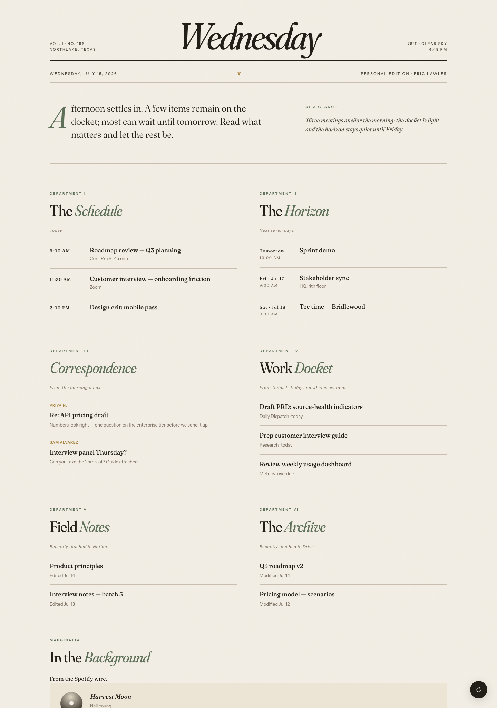

# The Daily Dispatch

[](https://github.com/erlawler/daily-dispatch/actions/workflows/ci.yml)
[](LICENSE)

A personal, single-page "morning briefing" that pulls my calendar, inbox, tasks,
notes, files, and now-playing into one calm, editorial dashboard — deployed to the
edge so it loads on **any device and any network** — plus a 7am email + phone-push
digest of the same briefing.

> Built to scratch a real itch, and to keep my hands on the full product loop:
> framing the problem, making build-vs-buy and model-selection trade-offs, and
> shipping something end-to-end.



*(Rendered with sample data — the live instance is identity-gated.)*

## The problem

My day's context lives in six different apps. First thing every morning I was
tab-hopping across Google Calendar, Gmail, Drive, Notion, Todoist, and Spotify just
to get oriented.

**Goal:** one URL I can bookmark anywhere that answers "what does today look like?"
in under five seconds — and that stays private to me.

## What it does

A newspaper-styled dashboard with six "departments," plus a one-line editorial
"glance" summary written by an LLM:

| Section | Source |
| --- | --- |
| The Schedule | Google Calendar — today's timed events |
| The Horizon | Google Calendar — next 7 days |
| Correspondence | Gmail — recent primary-inbox threads (Monday reaches back over the weekend) |
| Work Docket | Todoist — today + overdue |
| Field Notes | Notion — recently edited pages |
| The Archive | Google Drive — recently modified files |
| Marginalia | Spotify — now playing / recently played |
| "At a glance" | Claude Haiku — one calm sentence summarizing the day |

The same pipeline also powers a **morning digest**: on weekday mornings at 7:00 AM
Central the Worker delivers the briefing as an HTML email (Resend) and a phone push
(Pushover). Each channel is optional and activates only when its keys are
configured. The schedule is decided in code and covered by unit tests, for reasons
in [Reliability](#reliability).

## Architecture

```
        Browser  ──HTTPS──▶  Cloudflare Access  (identity gate: my email only)
                                   │
                                   ▼
                       Cloudflare Pages
                       ├── static dashboard (HTML/CSS/JS)
                       └── Pages Function  /api/dashboard  (server-side proxy)
                                   │  + shared secret header
                                   ▼
                       Cloudflare Worker  (TypeScript)
                       ├── Google (Calendar · Gmail · Drive)
                       ├── Notion · Todoist · Spotify    (parallel, per-source health)
                       ├── Claude Haiku  (the "glance" sentence)
                       └── KV  (OAuth tokens · payload cache · digest day-marker)
                                   ▲
                                   │  hourly cron · sends once, 7:00 AM Central
                                   └─▶  digest: email (Resend) + push (Pushover)
```

Every piece of personal data travels through the site's **own origin**. A Pages
Function proxies `/api/dashboard` to the Worker server-side, attaching a shared
secret; the browser never sees the Worker URL or the key. The Worker fans out to
every service in parallel and returns a single JSON payload the frontend renders,
cached in KV for five minutes so a reload costs nothing. (The two third-party calls
the page makes directly, a keyless weather lookup and Google Fonts, carry no
account data and no credentials.)

## AI product decisions

The interesting choice here isn't *using* AI — it's how little of it to use, and
where.

- **Right-sized model.** The one generative task is a single editorial sentence,
  so it runs on **Claude Haiku** at roughly **$0.001 per load (~$0.03/month)**.
  A frontier model would produce a similar sentence at ~100× the cost — paying
  frontier prices for a summarization task this small is negligence, not ambition.
- **Deterministic where determinism wins.** Sections are formatted client-side
  from structured API data. LLMs are for judgment, not for date formatting.
- **Where a frontier model *would* earn its cost** (see roadmap): correspondence
  triage and reply drafting — multi-document reasoning over inbox + calendar +
  tasks, where output quality compounds. That's a Claude Fable 5-class job, and
  it's deliberately *not* v1.
- **Cost ceiling by design.** The API key is capped at $5/month at the provider —
  a hard budget, not a hope.

## Reliability

- **Per-source health, honestly surfaced.** Every integration reports `ok` or
  `error` in the payload. A dead OAuth token renders as *"Can't reach Google —
  likely needs re-auth"* instead of impersonating a quiet day. (This distinction
  found a real expired-token failure that graceful degradation had been hiding.)
- **Graceful degradation.** One flaky service never blanks the briefing — the
  other five sections render regardless.
- **The schedule is code, not a cron expression.** The digest originally declared
  its days as `0 12 * * 1-5`. Thirty days of delivery records showed what actually
  happened: it ran every Sunday, and never once on a Friday. Weekday, hour, and
  DST are all decided in `decideDigest()` now, where they are explicit and pinned
  by tests. The cron just fires hourly and the code chooses.
- **Missed runs get caught, not lost.** Scheduled invocations are best effort, and
  two of them silently vanished over that same month. Later fires act as catch-ups
  through 9am, and a KV day-marker makes delivery at-most-once, so a dropped run
  costs a late briefing instead of no briefing.
- **Delivery is logged.** Every run records what it decided and what each channel
  returned. A dead Resend key no longer looks exactly like a quiet morning.

## Security model

Three independent layers, so my calendar/inbox/tasks are never publicly reachable:

1. **Cloudflare Access** gates the custom domain to a single identity (my email) —
   unauthenticated requests get bounced to a login.
2. **Pages Function** holds the shared secret server-side (never shipped to the
   browser) and refuses any hostname except the gated custom domain, so the public
   `*.pages.dev` URL can't be used as a bypass.
3. **Worker** rejects any request missing the secret header (constant-time
   comparison).

No credentials live in this repo — every token/secret is stored in Cloudflare
(Worker Secrets / Pages env), and `.gitignore` excludes `.env`/`.dev.vars`.

## Repo layout

```
daily-dispatch/
├── frontend/index.html        # the editorial dashboard (static)
├── functions/api/dashboard.js # Pages Function: server-side proxy + host lock
├── worker/                    # Cloudflare Worker (TypeScript)
│   ├── src/
│   │   ├── index.ts           # /api/dashboard entry + secret guard + cron
│   │   ├── dashboard.ts       # shared data builder + per-source health
│   │   ├── digest.ts          # send decision + email (Resend) + push (Pushover)
│   │   ├── cache.ts           # short-lived KV cache for the built payload
│   │   ├── auth.ts            # Google + Spotify OAuth refresh (KV-cached)
│   │   ├── time.ts            # timezone-aware date + weekday helpers
│   │   ├── synthesize.ts      # the Haiku "glance" sentence
│   │   └── services/          # google · notion · todoist · spotify
│   └── test/                  # vitest unit tests (send schedule, DST, date logic)
├── .github/workflows/ci.yml   # typecheck + tests on every push
└── scripts/                   # one-time OAuth / setup walkthroughs
```

## Running it yourself

```sh
cd worker
npm install
npm run typecheck
npm test           # 30 unit tests, including the send-schedule and DST proofs
npm run dev        # local Worker on :8787
```

The frontend is any static host; point its `WORKER_URL` (or a same-origin proxy) at
the Worker. OAuth/app setup for each service is documented in `scripts/`.

## What I'd build next

Prioritized the way I'd run any roadmap — by impact against effort, with the
frontier-model work gated behind proof it earns its cost:

1. **Now — correspondence triage.** Classify the morning's email by
   action-needed vs FYI and draft one-line suggested replies, human-in-the-loop.
   First feature that justifies a frontier model (Claude Fable 5-class):
   multi-source reasoning where quality compounds and a weak model is worse than
   none.
2. **Next — instrument the delivery path.** The schedule defect above was found by
   reading a month of delivery records by hand, which is a bad way to learn your
   product skipped every Friday. Workers Analytics Engine on send outcomes, load
   counts, and digest opens, with an alert when a weekday morning passes with
   nothing sent. Cheap, and it closes the loop that manual review just proved is
   open.
3. **Later — template-ize.** URLs and identity are config now; sources are still
   hardcoded. Making those declarative is what stands between this and something
   another person could deploy without touching code.

## Tech

TypeScript · Cloudflare Workers, Pages, KV & Cron Triggers · Wrangler v4 ·
Vitest + GitHub Actions · Anthropic Claude (Haiku) · Google / Notion / Todoist /
Spotify REST APIs · Resend · Pushover · vanilla HTML/CSS/JS frontend (Fraunces +
Instrument Sans).
